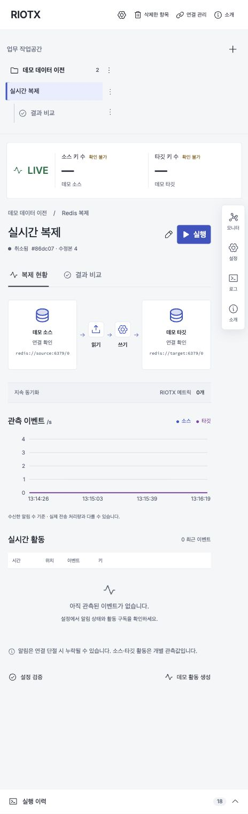
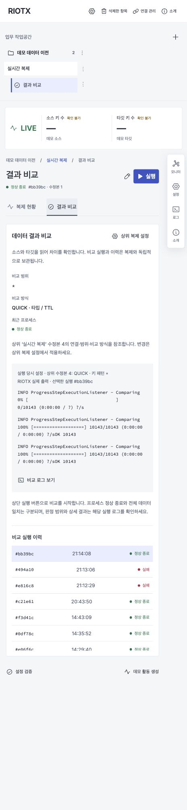
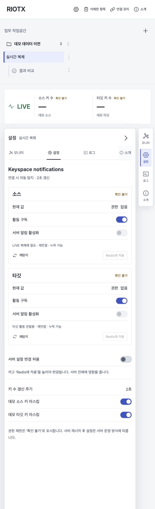
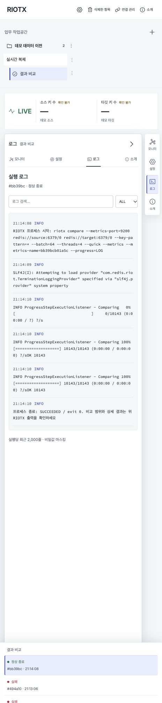
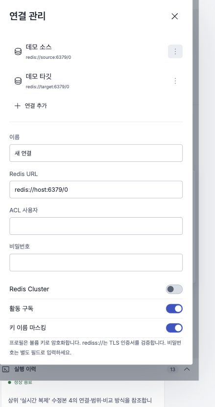
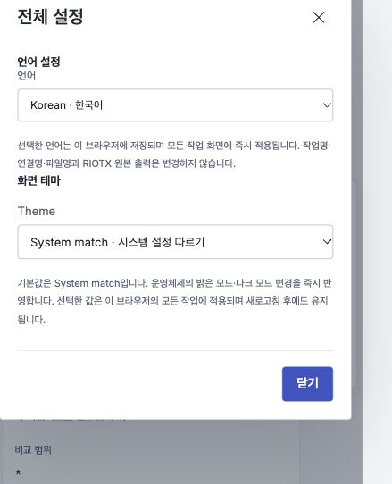
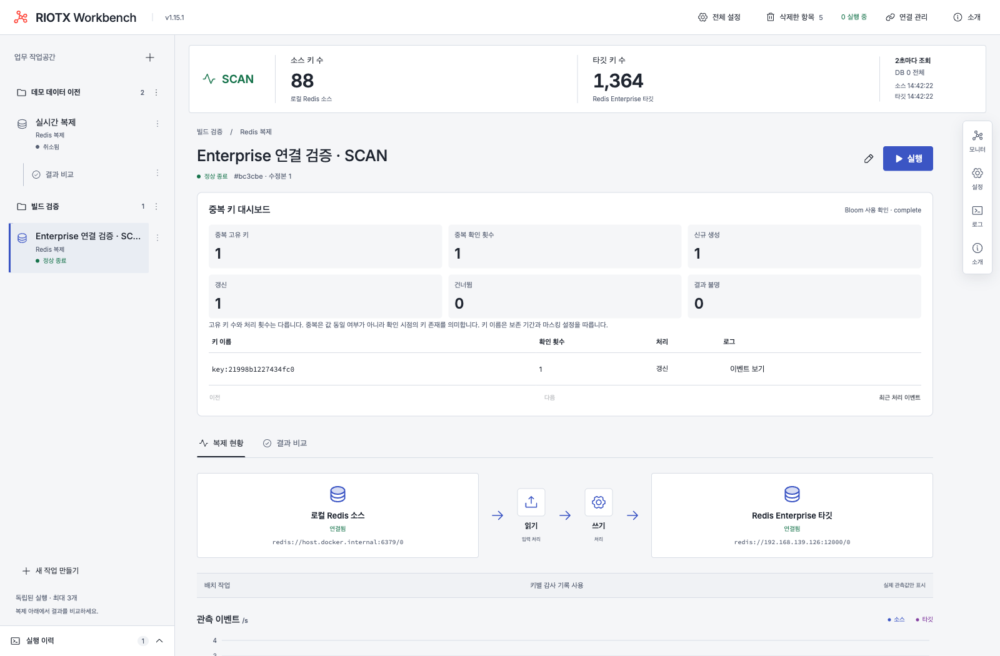

# RIOTX Workbench

Redis 데이터 이전·실시간 복제·파일 import·결과 비교를 웹에서 실행하고 모니터링하는 English·Korean UI를 지원하는 워크벤치입니다. React UI, FastAPI, RIOTX를 하나의 Docker 이미지로 제공합니다.

## UI 주요 화면

아래는 **2026-10-26 로컬 Workbench에서 직접 캡처한 화면**입니다. 현재 테스트 Redis 서버는 삭제되어 소스·타깃 키 수와 알림 상태가 **‘확인 불가’**로 표시됩니다. 결과 비교와 로그는 이전에 저장된 실행 이력이며, 현재 진행 중인 복제나 새 검증 결과를 뜻하지 않습니다.

화면은 브라우저 폭에 반응합니다. 넓은 화면에서는 작업 목록·중앙 작업 화면·우측 서랍으로 구성되며, 아래처럼 좁은 폭에서는 작업 목록이 위로 이동하고 서랍이 작업 화면 위에 열립니다. 이미지를 클릭하면 원본을 볼 수 있습니다.

### 1. 복제 현황과 데이터 흐름

업무 작업공간에서 복제 작업을 선택하면 **소스 → 읽기 → 쓰기 → 타깃** 흐름, 관측 이벤트 그래프와 최근 활동을 확인합니다. LIVE 모드에서는 선택한 소스·타깃 DB의 키 수를 상단에서 계속 조회합니다. 오른쪽 메뉴로 모니터·설정·로그·소개 서랍을 열고 닫습니다.

[](docs/screenshots/01-replication-overview.jpg)

<details>
<summary><strong>2. 복제 하위 메뉴의 결과 비교</strong></summary>

**복제 현황 → 결과 비교**에서 상위 복제의 연결·키 범위·비교 방식을 참조합니다. 실행 당시 설정과 RIOTX 실제 출력, 비교 작업의 독립된 실행 이력을 함께 확인할 수 있습니다. **프로세스 정상 종료나 키 수 일치만으로 전체 데이터가 같다고 판단하지 않습니다.**

[](docs/screenshots/02-result-comparison.jpg)

</details>

<details>
<summary><strong>3. 소스·타깃 알림 탐지와 설정 서랍</strong></summary>

**우측 설정**에서 양쪽 Redis의 `notify-keyspace-events` 상태를 각각 탐지하고 활동 구독 여부를 선택합니다. 구독 옵션과 Redis 서버 설정 변경은 분리되어 있습니다. 서버 플래그는 **서버 설정 변경 허용 → Redis에 적용**을 눌러야 변경됩니다. 서랍을 접으면 중앙 작업 공간을 더 넓게 사용할 수 있습니다.

[](docs/screenshots/03-notification-settings.jpg)

</details>

<details>
<summary><strong>4. 실행 이력 서랍과 상세 로그</strong></summary>

하단 **실행 이력**을 누르면 서랍이 위로 열립니다. 이력에서 실행을 선택하면 해당 실행의 **우측 로그**를 확인할 수 있으며, 검색과 로그 레벨 필터를 사용할 수 있습니다. Workbench는 실행당 최근 2,000줄을 보관하고 비밀값을 마스킹합니다. RIOTX의 원본 출력은 번역하지 않습니다.

[](docs/screenshots/04-run-history-logs.jpg)

</details>

<details>
<summary><strong>5. 연결 프로필 관리와 삭제 옵션</strong></summary>

상단 **연결 관리**에서 Redis URL, ACL 사용자·비밀번호, Cluster 여부, 활동 구독과 키 마스킹을 설정합니다. 각 프로필의 **⋮ → 연결 삭제**로 삭제 확인 화면을 엽니다. 사용 중인 실행이 있으면 삭제를 막고, 삭제 가능한 경우 작업의 연결 지정만 해제하며 기존 실행 이력·로그와 Redis 데이터는 보존합니다.

[](docs/screenshots/05-connection-management.jpg)

</details>

<details>
<summary><strong>6. 전체 설정의 언어와 테마</strong></summary>

**전체 설정**에서 **English / Korean**과 **System match / Dark**를 선택합니다. 기본값은 Korean과 System match입니다. 선택은 브라우저에 저장되고 화면에 즉시 반영됩니다. 언어를 바꿔도 작업명·연결명·파일명과 입력 중인 설정 값은 유지됩니다.

[](docs/screenshots/06-language-theme.jpg)

</details>

## Enterprise·MongoDB 확장 화면

2026-11-16 배포 서비스에서 검증한 중복 키 대시보드입니다. 신규 1건·갱신 1건, 고유 중복 1개를 기록했으며 테스트 데이터는 검증 후 삭제했습니다. 상단은 현재 연결된 DB 키 수입니다.

[](docs/screenshots/07-enterprise-audit.png)

## 문서

| 목적 | 문서 |
| --- | --- |
| MongoDB 일괄 가져오기·Enterprise·중복 감사 | [가져오기 가이드](docs/INGESTION_KO.md) |
| 처음 사용하기, 작업·파일·로그·테마 | [사용 가이드](docs/USER_GUIDE_KO.md) |
| 로컬 데모·운영 Docker 배포 | [Docker 배포 가이드](docs/DEPLOY_DOCKER_KO.md) |
| ECR·Terraform·AWS ECS 서비스 배포 | [AWS ECS 배포 가이드](docs/DEPLOY_ECS_KO.md) |
| 운영·보안·백업·업데이트 원칙 | [한국어 운영 가이드라인](docs/GUIDELINES_KO.md) |
| 구현 범위·API·기존 검증 상세 | [기술 설명](docs/TECHNICAL_NOTES_KO.md) |

## 빠른 시작: 로컬 데모

Docker Engine/Desktop와 Compose v2가 필요합니다.

```sh
git clone https://github.com/nethippo/riotx-workbench.git
cd riotx-workbench
docker compose up -d --build
```

브라우저에서 <http://127.0.0.1:8088>에 접속합니다.

| 서비스 | 로컬 접속 주소 |
| --- | --- |
| Workbench | `http://127.0.0.1:8088` |
| 테스트 Source Redis | `redis://127.0.0.1:6401/0` |
| 테스트 Target Redis | `redis://127.0.0.1:6402/0` |

기본 Compose는 전용 데모 Redis 2개와 데모 작업을 생성합니다. Docker 내부의 연결 주소는 `source:6379`, `target:6379`입니다. 실제 업무 Redis는 연결 관리에서 별도로 등록합니다.

## 운영 Docker 배포

데모 Redis 없이 애플리케이션만 실행하고, 접근 토큰을 설정합니다.

```sh
./scripts/deploy/docker.sh init
./scripts/deploy/docker.sh up
./scripts/deploy/docker.sh status
```

`deploy/docker/.env`에 생성된 `WORKBENCH_TOKEN`을 읽어 웹 로그인에 입력합니다. 토큰 파일은 Git에서 제외됩니다. 외부 접속, HTTPS와 백업은 [Docker 가이드](docs/DEPLOY_DOCKER_KO.md)를 확인하세요.

## AWS ECS 배포

Terraform과 AWS CLI v2, Docker Buildx로 ECR과 ECS 서비스를 배포합니다. AWS 리소스는 스크립트를 직접 실행할 때 생성되며 비용이 발생합니다.

```sh
cp infra/ecr/terraform.tfvars.example infra/ecr/terraform.tfvars
cp infra/ecs/terraform.tfvars.example infra/ecs/terraform.tfvars
# 두 설정 파일을 실제 리전·VPC·서브넷·ACM 인증서·Secret ARN으로 수정합니다.
./scripts/deploy/ecs.sh ecr-plan
./scripts/deploy/ecs.sh ecr-apply
./scripts/deploy/ecs.sh image
./scripts/deploy/ecs.sh plan
./scripts/deploy/ecs.sh apply
./scripts/deploy/ecs.sh status
```

구성은 **ECS on EC2 1대 + 단일 Workbench 태스크 + 암호화된 EBS + HTTPS ALB + Secrets Manager + CloudWatch Logs**입니다. 기존 VPC, 서브넷, ACM 인증서, 토큰 Secret을 사용합니다. 기본 ALB는 내부용입니다.

현재 앱의 SQLite WAL은 로컬 디스크를 전제로 하므로 EFS 공유 볼륨이나 태스크 수평 확장을 사용하지 않습니다. 배포 시 이전 태스크를 먼저 종료하므로 잠깐 중단될 수 있습니다. 구성 생성·정적 검증과 실제 AWS 배포 검증은 구분하며, 이 저장소의 추가 구성은 실제 계정에 apply하지 않았습니다. 자세한 사전 조건과 실행 순서는 [ECS 가이드](docs/DEPLOY_ECS_KO.md)에 있습니다.

## 주요 기능

- 업무 작업공간별 여러 잡 저장·설정 수정본·독립된 실행 이력
- Redis SCAN/LIVE 복제와 하위 메뉴의 QUICK/FULL 결과 비교
- MongoDB 커서·분할 청크·체크포인트 재개를 통한 일괄 가져오기
- Enterprise Proxy/Bloom 기본값, 정확한 기존 키 보호와 중복 키 대시보드·이벤트 로그
- 파일 기반 작업의 입력 레코드 집계, 메타데이터 감시, 교체 시 자동 재실행
- 선택한 Redis 소스·타깃 DB의 키 수를 2초마다 조회
- 양쪽 keyspace notifications 자동 탐지, 활동 구독과 서버 설정 변경의 분리
- 우측 모니터·설정·로그·소개 서랍과 좌측 하단 실행 이력 서랍
- 작업·작업공간의 복구 가능한 삭제와 로그 보존
- 전체 설정의 English/Korean 언어 선택과 System match 기본 테마·Dark 선택
- 연결 프로필별 삭제 옵션, 사용 중인 실행 보호와 기존 이력 보존
- 공식 RIOTX 배포 저장소를 통한 안정 버전 업데이트 안내

## 구조와 의존성

```text
backend/            FastAPI, SQLite, Redis 관측, RIOTX 실행
ui/                 React 화면과 프런트엔드 테스트
scripts/            RIOTX 업데이트, 데모 데이터 생성
scripts/deploy/     Docker/ECR/ECS 배포 도구
deploy/docker/      운영 Compose와 환경변수 예시
infra/ecr/          ECR Terraform 스택
infra/ecs/          ECS/EC2/EBS/ALB/IAM Terraform 스택
docs/               한국어 사용·배포·운영 문서
tests/              Python 단위·데모 통합 테스트
```

포함/최소 지원 RIOTX는 **1.15.1**입니다. ZIP 체크섬을 고정하여 빌드하고 실제 버전을 시작 시 확인합니다. 업데이트 원본은 [redis/riotx-dist](https://github.com/redis/riotx-dist)입니다.

Python 3.12, JRE 21, SQLite WAL, React 19, Vite 6을 사용합니다. Python 의존성은 `requirements.txt`, UI 의존성은 `ui/package-lock.json`, 런타임 정보는 `runtime.json`과 UI의 소개 메뉴에서 확인합니다.

## 검증

```sh
(cd ui && npm ci && npm run build && node --test tests/*.test.mjs)
docker compose build workbench
docker run --rm --entrypoint python \
  -v "$PWD/tests:/app/tests:ro" \
  -v "$PWD/scripts:/app/scripts:ro" \
  -v "$PWD/deploy/docker/.env.example:/app/deploy/docker/.env.example:ro" \
  riotx-workbench:1.0.0 -m unittest discover -s tests -p 'test_*.py' -v
./scripts/deploy/validate.sh
```

검증 결과와 제한은 [검증 기록](docs/VALIDATION_KO.md)에 정리했습니다.

단위 테스트는 임시 저장소를 사용합니다. `tests/integration.py`는 실제 데모 데이터·알림 설정을 변경하고 실행을 취소하므로 독립된 테스트 배포에서만 실행하세요.

## 데이터 보존과 한계

연결 프로필·암호화 키·SQLite·로그·업로드 파일은 `/data`에 함께 보관합니다. 백업할 때 이 디렉터리 전체를 보존해야 합니다. 실행 중인 RIOTX는 컨테이너 재시작 후 자동으로 이어지지 않습니다. keyspace Pub/Sub는 유실될 수 있으며, 키 수 일치나 정상 프로세스 종료만으로 데이터 일치를 보장하지 않습니다.

단일 운영자를 위한 도구입니다. SQL·SpEL을 입력할 수 있으므로 신뢰하는 운영자에게만 접근을 허용하세요. 다중 사용자 RBAC나 고가용성 제어 서버는 제공하지 않습니다.

## 라이선스

RIOTX 자체는 [배포 원본의 라이선스](https://github.com/redis/riotx-dist/blob/main/LICENSE.md)를 따릅니다. 사본은 [RIOTX-LICENSE.md](RIOTX-LICENSE.md)에 있습니다. JRE·Python/JavaScript 패키지와 글꼴에는 각각의 라이선스가 적용됩니다. RIOTX의 사용 범위와 라이선스 조건은 배포 전에 확인하세요.
