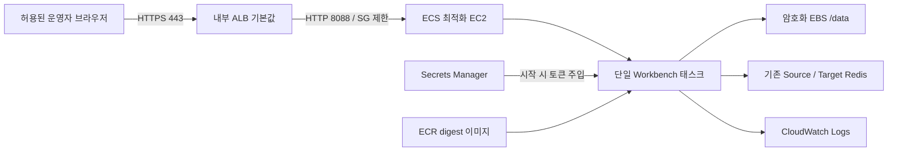

# AWS ECS + Terraform 배포 가이드

이 문서는 기존 AWS 네트워크에 Workbench를 배포하는 절차입니다. 스크립트를 제공하지만 AWS 계정에 자동 실행하지 않습니다. `plan`과 `apply`를 분리하여 검토한 계획만 적용합니다. 모든 명령은 저장소 루트에서 실행합니다.

## 1. 구성과 선택 이유



SQLite WAL은 네트워크 파일시스템을 지원하지 않습니다. 따라서 현재 앱은 EC2 호스트의 **로컬 ext4 EBS 볼륨**을 사용하며, Fargate/EFS·다중 Workbench 태스크·자동 수평 확장은 제공하지 않습니다. [SQLite 공식 WAL 제약](https://www.sqlite.org/wal.html)을 참고하세요.

- ECS 클러스터, ECS 최적화 Amazon Linux 2023 EC2 한 대, ECS 서비스 한 개를 만듭니다.
- desired count 1, 배포 최소 0%/최대 100%로 이전 태스크를 먼저 종료합니다. 업데이트 중 일시적으로 접근이 끊길 수 있습니다.
- 데이터 EBS는 별도 리소스로 보호합니다. 새 호스트 부팅 시 정확한 EBS NVMe serial을 찾아 마운트한 뒤에만 ECS 에이전트가 등록됩니다. 기존 파일시스템은 포맷하지 않습니다.
- 기본 ALB는 내부용이고, 클라이언트 CIDR을 명시해야 합니다. 인증서가 있는 HTTPS만 엽니다.
- 기본 `t3.large` + X86_64 이미지이며, ARM64는 이미지와 `t4g.large` 등 인스턴스를 함께 맞춥니다. 예시 인스턴스는 Nitro/NVMe EBS를 사용합니다.
- VPC, NAT/엔드포인트, Redis, ACM 인증서, Secret 값, DNS 레코드는 새로 생성하지 않습니다.

단일 호스트이므로 고가용성 배포가 아닙니다. 호스트 장애 시 수동 교체·볼륨 연결이 필요합니다. 여러 AZ로의 자동 장애 조치나 Fargate가 필요하면 먼저 상태 저장소·잡 실행 아키텍처를 분리해야 합니다.

## 2. 사전 준비

### 도구와 권한

- Terraform **1.10 이상, 2.0 미만**; 이 구성은 1.13.5로 검증합니다.
- AWS CLI v2와 배포 계정의 자격 증명/프로필
- Docker Engine/Desktop, Buildx, Bash, Python 3, Git
- Terraform 운영자에게 EC2/EBS·ECS·ECR·ELBv2·IAM/PassRole·CloudWatch Logs 생성/조회 권한 및 AMI SSM 파라미터 조회 권한이 필요합니다. 첫 ECS 사용 시 서비스 연결 역할 생성 권한도 필요할 수 있습니다.
- Secret 생성·인증서·DNS·네트워크 관리는 별도 권한으로 준비합니다. AWS 액세스 키를 `.tfvars`나 Git에 넣지 마세요.

```sh
export AWS_PROFILE=<배포용-프로필>
export AWS_REGION=ap-northeast-2
aws sts get-caller-identity
terraform version
docker buildx version
```

### 네트워크

동일 VPC 안에서 다음을 준비합니다.

1. 서로 다른 AZ의 ALB 서브넷 2개
2. EC2용 private 서브넷 1개. 그 AZ에 EBS를 만듭니다.
3. EC2가 ECR·S3 이미지 레이어·CloudWatch Logs·Secrets Manager·ECS/SSM과 공식 릴리스 조회에 접근할 수 있는 NAT 또는 필요한 VPC 엔드포인트/아웃바운드 경로
4. VPC DNS 지원과 실제 Redis까지의 라우팅

노드에는 public IP나 SSH 포트를 주지 않습니다. public 서브넷에 노드를 놓는 것만으로 인터넷 통신이 되는 것은 아닙니다. NAT/엔드포인트가 없으면 이미지 pull, 에이전트 등록, Secret 조회 등이 실패합니다. 외부 RIOTX 업데이트 조회에는 별도 인터넷 경로가 필요합니다. [AWS ECS 네트워킹 설명](https://docs.aws.amazon.com/AmazonECS/latest/developerguide/networking-outbound.html)을 참고하세요.

내부 ALB는 VPN/Direct Connect 등으로 브라우저에서 접근할 수 있어야 합니다. 인터넷 ALB를 원하면 `alb_internal=false`, Internet Gateway 라우팅이 있는 public ALB 서브넷 두 개, 운영자 IP CIDR을 지정합니다. `0.0.0.0/0`은 허용하지 않습니다.

### 인증서와 토큰

ALB와 같은 리전에 발급 완료된 ACM 인증서 ARN을 준비합니다. 접속할 도메인이 인증서 SAN에 있어야 합니다.

토큰 Secret은 Terraform 외부에서 **일반 문자열 값**으로 생성합니다. JSON 객체가 아닙니다. 다음은 랜덤 토큰 생성 예이며 출력에는 ARN만 표시됩니다.

```sh
umask 077
riotx_token_file=$(mktemp)
openssl rand -hex 32 | tr -d '\n' > "$riotx_token_file"
aws secretsmanager create-secret --region "$AWS_REGION" \
  --name riotx/workbench/token --secret-string "file://$riotx_token_file" \
  --query ARN --output text
# 토큰을 승인된 비밀번호 저장소에 보관한 후 임시 파일을 삭제합니다.
rm -f "$riotx_token_file"
```

웹 입력에 필요한 토큰은 Secrets Manager 콘솔에서 확인할 수 있습니다. 토큰 값을 Terraform에 전달하지 않으며, ECS task definition에는 Secret ARN만 들어갑니다. 고객 관리 KMS 키로 Secret을 암호화했다면 `secret_kms_key_arn`을 지정하고 키 정책도 실행 역할의 복호화를 허용해야 합니다.

## 3. ECR 생성

```sh
cp infra/ecr/terraform.tfvars.example infra/ecr/terraform.tfvars
# region과 repository_name을 수정합니다.
./scripts/deploy/ecs.sh ecr-plan
./scripts/deploy/ecs.sh ecr-apply
```

ECR은 태그 불변, 저장 암호화와 push 시 스캔을 설정합니다. 저장소에 이미지가 있으면 기본 destroy는 실패하도록 `force_delete=false`입니다. 자동 이미지 정리 규칙을 만들지 않으므로 롤백 이미지가 뜻하지 않게 삭제되지 않습니다. 오래된 이미지 보관 비용은 운영자가 관리합니다.

## 4. 이미지 빌드와 업로드

현재 커밋 기준으로 이미지를 올립니다. 변경 파일이 있으면 커밋하거나 명시적으로 고유 태그를 지정해야 합니다.

```sh
./scripts/deploy/ecs.sh image
# 또는, 별도 고유 태그:
IMAGE_TAG=release-20261021-1 ./scripts/deploy/ecs.sh image
```

기본은 `linux/amd64`입니다. ARM64는 다음과 같이 빌드합니다.

```sh
PLATFORM=linux/arm64 ./scripts/deploy/ecs.sh image
```

스크립트가 ECR에 로그인하고 Buildx로 이미지를 올린 뒤 실제 digest를 조회합니다. 결과를 Git에서 제외되는 `infra/ecs/image.auto.tfvars.json`에 저장합니다. ECS는 mutable tag 대신 `repository@sha256:...`를 사용합니다. 같은 불변 태그를 다시 push하면 거부될 수 있으므로 기존 digest를 재사용하거나 새 태그를 사용하세요.

Apple Silicon에서 기본 AMD64 빌드는 에뮬레이션으로 느릴 수 있습니다. ARM64를 선택하면 ECS 설정의 `instance_type`도 Graviton 타입으로 맞춰야 합니다.

## 5. ECS 입력값 작성

```sh
cp infra/ecs/terraform.tfvars.example infra/ecs/terraform.tfvars
```

| 변수 | 설정 |
| --- | --- |
| `region`, `name` | ECR과 같은 리전 권장, 리소스 접두사 |
| `vpc_id` | 기존 VPC |
| `alb_subnet_ids` | 같은 VPC, 서로 다른 AZ의 서브넷 2개 이상 |
| `instance_subnet_id` | 노드 private 서브넷, EBS의 AZ 결정 |
| `alb_internal` | 기본 true. 인터넷용은 false와 public ALB 서브넷 |
| `allowed_client_cidrs` | VPN CIDR 또는 운영자 공인 IPv4 `/32` 등 |
| `certificate_arn` | 발급 완료된 동일 리전 ACM 인증서 |
| `token_secret_arn` | 앞에서 만든 일반 문자열 토큰 Secret의 ARN |
| `instance_type` | X86_64 기본 `t3.large`, ARM64 예 `t4g.large` |
| `container_image`, `architecture` | 이미지 스크립트의 JSON이 제공; 중복 설정하지 않기 |
| `data_size_gib` | EBS 기본 30GiB. 확장 후 ext4 크기 확장은 별도 확인 |
| `task_cpu`, `task_memory` | 기본 1024 CPU units / 4096MiB |
| `max_concurrent_runs` | 기본 1. 여러 JVM의 메모리를 고려하여 조정 |
| `redis_security_group_ids`, `redis_port` | 선택 사항. Workbench 노드 SG로부터 Redis 인바운드 규칙 추가 |

외부 Redis나 별도 VPC는 해당 네트워크/서비스의 접속 허용 절차도 필요합니다. `redis_security_group_ids`를 설정하면 기존 Redis SG에 규칙을 추가하므로 소유자와 협의합니다. 서로 다른 포트의 여러 서버는 각 소유 환경에서 규칙을 관리하세요. Redis 접속 비밀번호는 여기에 쓰지 않고 배포 후 UI에 등록합니다.

## 6. 계획 검토와 적용

```sh
./scripts/deploy/ecs.sh plan
./scripts/deploy/ecs.sh apply
./scripts/deploy/ecs.sh status
terraform -chdir=infra/ecs output
```

계획은 `deployment.tfplan`에 저장됩니다. `apply`는 이 저장된 계획만 적용합니다. 값 변경 후에는 새로 plan해야 합니다. 새 계획 생성이 실패하면 이전 계획을 적용하지 않도록 saved plan을 무효화합니다. saved plan과 state에도 환경 정보가 있으므로 비공개 보관합니다. ECR과 ECS는 각각 별도 state입니다.

초기 EC2가 뜬 뒤 EBS 연결을 기다리고, ECS 등록·이미지 pull·태스크 시작·ALB 헬스체크를 거칩니다. 서비스가 정상 상태가 될 때까지 Terraform이 기다립니다. 실패 시 ECS 이벤트와 다음 로그를 확인하세요.

```sh
aws logs tail /ecs/riotx-workbench --region "$AWS_REGION" --since 10m
# SSM Session Manager로 접속할 수 있는 권한이 있는 운영자:
aws ssm start-session --target <terraform-output-instance_id> --region "$AWS_REGION"
# EC2 내부:
# sudo journalctl -u riotx-data.service -u ecs.service
# sudo findmnt /var/lib/riotx-data
```

노드는 ECS 최적화 AL2023 AMI를 SSM에서 조회합니다. 이후 SSM의 새 AMI만으로 자동 호스트 교체를 일으키지 않도록 `ignore_changes=[ami]`를 설정합니다. 호스트 패치는 별도 유지보수 창에서 AMI를 검토하고 `plan -replace=aws_instance.node` 등 명시적인 교체 절차를 사용하세요. User data/인스턴스 타입 변경도 교체를 유발할 수 있으므로 매 plan에서 확인합니다.

## 7. DNS와 첫 접속

`alb_dns_name` 출력으로 도메인의 CNAME 또는 Route 53 Alias를 연결합니다. 실제 접속은 **ACM 인증서에 포함된 도메인**으로 해야 합니다. AWS ALB 기본 DNS 이름으로 HTTPS 접속하면 인증서 이름이 맞지 않습니다. DNS 레코드는 이 Terraform에서 자동 생성하지 않습니다.

```sh
curl -fsS https://workbench.example.com/api/health
```

UI에 토큰을 입력하고 연결·작업을 등록합니다. ECS 배포는 DEMO_ENABLED=false이므로 초기 작업 목록이 비어 있습니다. API 헬스는 앱 생존 여부이며, 실제 Redis 연결과 LIVE 알림 상태는 UI에서 따로 확인합니다.

## 8. 업데이트·롤백

1. 진행 중인 잡과 파일 자동 가져오기 토글을 확인합니다.
2. 자동 실행을 중지하고 현재 실행을 정상 종료합니다. 이미 쓴 Redis 데이터는 자동 되돌리지 않습니다.
3. 데이터 스냅샷을 만들고 새 커밋 이미지를 push합니다.
4. 새 digest로 plan을 검토한 뒤 apply합니다.
5. 헬스·로그·Redis 연결·필요한 결과 비교를 확인합니다.

```sh
git pull --ff-only
./scripts/deploy/ecs.sh image
./scripts/deploy/ecs.sh plan
./scripts/deploy/ecs.sh apply
```

배포 동안 태스크가 교체되므로 잡은 이어지지 않습니다. 서비스 배포 circuit breaker는 태스크 시작 실패 시 이전 배포로 롤백을 시도하지만, Redis 쓰기나 SQLite 데이터 스키마를 되돌리지는 않습니다. 수동 롤백은 보관한 이전 image digest를 `image.auto.tfvars.json`에 지정하고 새 plan/apply로 진행합니다. 이전/현재 버전의 데이터 호환성을 확인하세요.

토큰 Secret을 바꾸어도 기존 태스크의 환경변수는 자동 갱신되지 않습니다. 진행 중 잡을 종료한 후 ECS `force-new-deployment` 등으로 태스크를 교체해야 합니다. 이미지 교체처럼 중단이 발생합니다.

## 9. 백업·복구·리소스 정리

일관된 스냅샷은 Workbench 잡과 컨테이너를 정상 종료한 상태에서 수행합니다. Terraform의 desired count는 1이므로 점검 중 자동 재배포/재적용을 피하고, 서비스 count를 일시 0으로 낮춘 뒤 실행 중 태스크가 0개인지 확인합니다.

```sh
aws ecs update-service --region "$AWS_REGION" --cluster riotx-workbench \
  --service riotx-workbench --desired-count 0
# running/pending count 0과 태스크 정상 종료를 확인한 다음:
aws ec2 create-snapshot --region "$AWS_REGION" --volume-id <data_volume_id> \
  --description 'RIOTX Workbench stopped consistent backup'
# snapshot 완료 상태 확인 후 원래 서비스 count로 복구:
aws ecs update-service --region "$AWS_REGION" --cluster riotx-workbench \
  --service riotx-workbench --desired-count 1
```

EBS에는 `/data` 전체가 있습니다. 복원은 같은 AZ에 새 볼륨을 만들고, 서비스를 중지한 후 기존 데이터를 보존하면서 Terraform import/연결과 파일 권한을 정합하게 맞추는 절차로 진행합니다. 이 템플릿은 무중단 볼륨 전환을 자동화하지 않습니다. 원본 Redis는 별도 백업 대상입니다.

데이터 EBS의 `prevent_destroy` 때문에 전체 `terraform destroy`는 실패하도록 설계했습니다. 삭제가 필요하면 먼저 백업을 확인하고 데이터 보존/폐기를 명시적으로 결정한 뒤 해당 보호 설정을 검토하세요. ECR은 이미지가 남아 있으면 삭제되지 않습니다. 로컬 state를 삭제한다고 AWS 리소스가 정리되지는 않습니다.

EC2, EBS, ALB, ECR, CloudWatch, 사용하는 NAT/데이터 전송에 비용이 발생합니다. 중단·정리 때도 EBS 스냅샷·ECR·로그·기존 NAT 등의 잔존 비용을 확인하세요.

## 10. Terraform state와 검증 범위

예시는 로컬 state로 시작합니다. `.terraform`, `.tfstate`, `.tfvars`, plan, 이미지 변수 JSON은 Git/Docker 빌드 컨텍스트에서 제외됩니다. `.terraform.lock.hcl`은 재현 가능한 공급자 설치를 위해 Git에 포함합니다. 팀 운영은 암호화된 S3 state backend와 잠금 정책을 별도로 준비하고 `terraform init -migrate-state`로 이전하세요. 두 스택의 state key는 분리합니다.

저장소의 검증 스크립트는 AWS 리소스를 만들지 않는 fmt/validate와 mock plan 테스트를 사용합니다. 실제 계정의 IAM 권한, NAT, 인증서, 용량, Redis 연결·ALB 배포 성공까지 보장하지 않습니다. 본 구성을 실제 AWS에 apply한 이력으로 해석하지 마세요.

### 공식 참고 자료

- [ECS 최적화 AMI](https://docs.aws.amazon.com/AmazonECS/latest/developerguide/ecs-optimized_AMI.html)
- [SSM을 통한 ECS AMI 조회](https://docs.aws.amazon.com/AmazonECS/latest/developerguide/retrieve-ecs-optimized_AMI.html)
- [ECS 에이전트와 cloud-init 시작 순서](https://docs.aws.amazon.com/AmazonECS/latest/developerguide/ecs-agent-install.html)
- [ECS 네트워킹과 외부 연결](https://docs.aws.amazon.com/AmazonECS/latest/developerguide/networking-outbound.html)
- [ECS 로드밸런서](https://docs.aws.amazon.com/AmazonECS/latest/developerguide/service-load-balancing.html)
- [Terraform AWS 공급자](https://registry.terraform.io/providers/hashicorp/aws/latest/docs)
