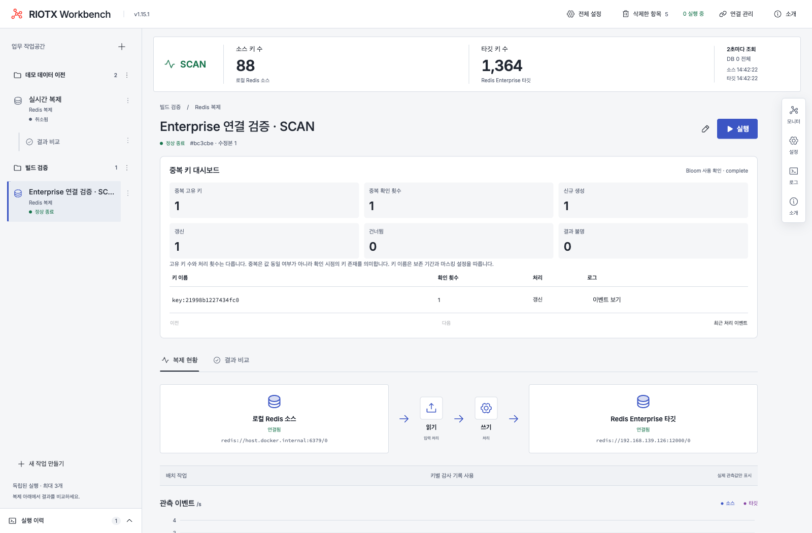

# 배포 구성 검증 기록

검증일: 2026-10-21 (Asia/Seoul)

| 항목 | 결과 |
| --- | --- |
| Terraform | 1.13.5, AWS provider 6.69.1; 공식 체크섬/서명 확인 |
| Terraform fmt/validate | ECR·ECS 스택 통과 |
| Terraform mock plan | ECR 1개 + ECS 8개 통과, AWS 리소스 생성 없음 |
| Compose 설정·Bash 문법 | 운영 Compose config와 스크립트 문법 통과 |
| Python 단위 테스트 | 기존 기능 32개 + 배포 스크립트 7개 통과 |
| UI 테스트 | 18개 통과 |
| 내부 문서 링크 | README와 한국어 가이드 경로 확인 |

Mock plan은 단일 writer/stop-first, 암호화된 로컬 저장소, 내부 ALB 기본값, HTTPS, Secret ARN 주입, 명시적인 Redis SG 연결을 확인합니다. 공개 전체 CIDR·mutable image·아키텍처 불일치·메모리 부족·비 NVMe 노드의 거부와 ARM64 구성을 검사합니다.

배포 스크립트 단위 테스트는 도구를 stub으로 대체합니다. 기존 토큰 파일 보존과 권한 0600, 볼륨을 삭제하지 않는 stop, 짧은 토큰 거부, saved plan 필수, 검증 실패 시 오래된 계획 제거, 이미지 push 실패 시 기존 digest 보존을 확인합니다.

**실제 AWS apply, ECR push, ECS 서비스 기동, 실제 계정의 IAM/네트워크/인증서 검증은 수행하지 않았습니다.** 위 결과는 해당 계정에서의 배포 성공이나 무중단을 보장하지 않습니다. 실제 환경은 DEPLOY_ECS_KO.md의 사전 조건부터 검토하세요. 기존 로컬 Workbench·Redis·데이터 생성기는 이 작업에서 재시작하지 않았습니다.

## 2026-11-16 Enterprise·MongoDB 확장

- Python 회귀 테스트 58개, UI 테스트 22개, Vite 빌드 통과.
- 실제 호스트 localhost:6379 소스와 지정 Enterprise Proxy 타깃으로 SCAN 자료형(String/Hash/List/Set)·TTL 보존, 기존 키 유지, 갱신·중복 집계·이벤트 연결 검증.
- 의도적인 Bloom 양성/실제 키 부재에서도 신규 데이터를 기록하며, 필터 타입 오류 시 정확한 쓰기로 대체함을 확인.
- LIVE 값·TTL·삭제 전파와 취소 확인. 테스트 중에만 소스 알림을 활성화하고 이전 플래그로 복구.
- 임시 MongoDB 8.0에서 BSON 문서 180개, JSONL 청크 5개, 취소→동일 실행 재개, Decimal128 등 Canonical JSON 보존과 성공 청크 삭제 검증.
- 기존 소스 88개·타깃 1,364개 키의 DUMP 해시가 변하지 않았음을 확인. 생성한 테스트 접두사와 해당 Bloom 메타데이터만 정리.
- 배포된 서비스에서도 신규 1건·기존 키 갱신 1건, 고유 중복 1개, 이름 마스킹과 이벤트 조회 확인. 검증 작업 이력은 `빌드 검증` 작업공간에 남기고 테스트 데이터는 삭제.
- 브라우저에서 Enterprise/Proxy/Bloom 저장값, 기본값 설정, 영문 전환, 중복 키→로그 서랍 연결을 확인. 콘솔에는 기존 favicon.ico 404 외 애플리케이션 오류 없음.
- 이번 변경의 실제 AWS 배포, 외부 MongoDB 계정·TLS, OSS Cluster API, Active-Active는 검증하지 않음. 관리형 모드의 지원 범위는 [가져오기 가이드](INGESTION_KO.md) 참조.

